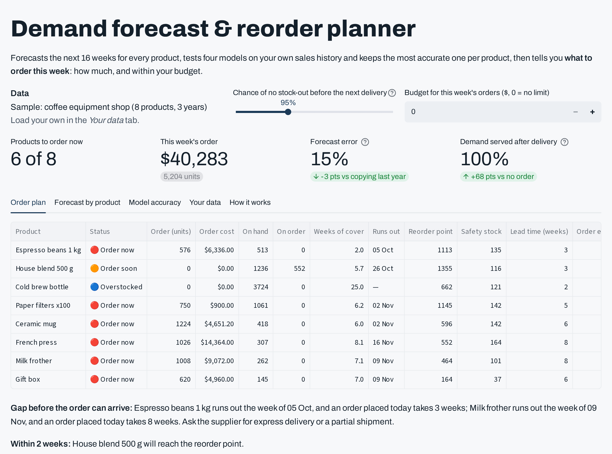

# Demand forecast & reorder planner

**Live demo:** https://slimaneoptic-planner.streamlit.app

Forecasts the next 16 weeks for every product, tests four forecasting models on the shop's own history and keeps the most accurate one per product, then says **what to order this week**: which products, how many units, and what to buy first when the budget is limited. It starts with a sample coffee-equipment shop (8 products, 3 years of weekly sales), and you can **upload your own sales file**.



## Highlights
- **Four models, tested on your data:** same week last year, moving average, Holt-Winters and a gradient-boosting model trained across all products (season, last year's pattern, trend, promotions). Each is scored on weeks we already know, including the same season last year, and the best one is kept per product.
- **Honest ranges:** the 80 % band comes from each model's own past misses.
- **Order plan:** reorder point, safety stock at your service level, order quantity in whole cases with the supplier's minimum, weeks of cover, and the week each product runs out.
- **Lost sales counted correctly:** an order that lands after a stock-out doesn't pretend to recover the sales missed before it arrives.
- **Budget optimizer:** when the plan costs more than the budget, Google OR-Tools CP-SAT chooses quantities over 300 demand scenarios per product to protect the most margin per dollar.
- **Excel export:** order plan, weekly forecasts with ranges, model accuracy, settings used.

## Your data
A CSV or Excel file with **date, product, units** (daily or weekly; `sku`, `quantity` and similar names also work) and an optional `promo` column. Then enter stock, open orders, lead time, order frequency, cost, price, case size and minimum order per product in the app.

## Run locally
```bash
pip install -r requirements.txt
streamlit run app.py
pytest -q tests
```

## Need this for your business?
Connection to Shopify, WooCommerce, an ERP or Google Sheets, several warehouses and suppliers, container and pallet limits, shelf life, and a weekly plan sent by email. I build these tools. https://www.upwork.com/freelancers/~01d6ae0f1a06a43ac0
